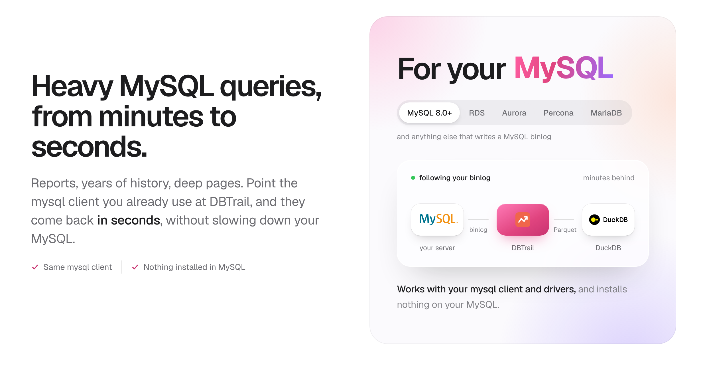

<div align="center">



**HTAP for MySQL and MariaDB. Transactions stay on your server; heavy queries come back in seconds from a columnar copy that follows your binlog, routed automatically on the same connection, with no ETL and nothing installed on your MySQL.**

[](https://github.com/dbtrail/dbtrail/releases/latest)
[](LICENSE)
[](https://github.com/dbtrail/dbtrail/actions)

[Website](https://dbtrail.com) · [Quick Start](https://www.dbtrail.com/docs/quickstart/) · [Docs](https://www.dbtrail.com/docs/) · [Blog](https://blog.dbtrail.com)

</div>

```sh
mysql -h <dbtrail host> -P 3309 -u shop -p
```

```sql
SELECT c.tier, count(*) AS orders, round(sum(o.total), 2) AS revenue
FROM orders o JOIN customers c ON c.id = o.customer_id
GROUP BY c.tier ORDER BY revenue DESC;
```

<p align="center"><em>The same SQL your application sends. DBTrail answered it from the copy, and your MySQL never ran it.</em></p>

---

## What you can do

- **Run heavy queries in seconds.** Totals and rankings over whole tables,
  trends over years of data, page 5,000 of a listing. In our test, the
  heaviest of 14 real reports took 225 seconds on a MySQL replica and 7.9 with
  DBTrail; the 14 ran 6.5 times faster on average.
  [The numbers](https://www.dbtrail.com/docs/guides/query-with-a-mysql-client/routing/#numbers)
- **Keep one connection for your application.** With routing on, DBTrail
  sends writes, transactions and lookups by key to your MySQL, and answers the
  heavy reads from the copy. Your application's SQL stays as it is. It also
  works behind ProxySQL.
  [Connect your application](https://www.dbtrail.com/docs/guides/query-with-a-mysql-client/routing/)
- **Point dashboards at it.** Metabase, Grafana or any tool that speaks MySQL.
  [Dashboards](https://www.dbtrail.com/docs/guides/dashboards/)
- **Undo a wrong change.** DBTrail keeps every change on your MySQL server, before and after, and writes the SQL that undoes the ones you didn't want.
  You review it and you run it.
  [Undo a wrong change](https://www.dbtrail.com/docs/guides/recovery/)
- **See a table as it was yesterday at 14:30**, or every version of one row,
  with `AS OF` from your mysql client.
  [Restore tables to a moment](https://www.dbtrail.com/docs/guides/pitr/)
- **Ask Claude what changed.** Connect Claude, or any MCP client, and ask in
  plain words: "what was deleted from orders in the last hour?", "how did
  customer 42 look on Monday?", "give me the SQL that puts it back". Its tools
  only read, and it never runs SQL on your MySQL.
  [Connect Claude](https://www.dbtrail.com/docs/claude/setup/)

## Where it runs

DBTrail reads your binlog over the replication protocol, the way a replica
does. Nothing is installed on your MySQL: no plugin, no agent, no triggers.
You don't move to another database or another cloud. DBTrail runs on your own
machines, next to MySQL, Percona Server, MariaDB, Amazon RDS or Aurora, and
the copy is plain Parquet files on your disk or in your S3 bucket.

## Install

You need Docker with Compose, and the `mysql` client.

```sh
curl -fsSL https://raw.githubusercontent.com/dbtrail/dbtrail/main/install.sh | sh
```

It starts DBTrail and opens **http://127.0.0.1:8090**. Connect your MySQL in
the form, take the first copy, turn on the MySQL port, and run a heavy query:
the five steps are in the [Quick Start](https://www.dbtrail.com/docs/quickstart/).

For a server you keep running, the same setup as a compose file and a few API
calls you can keep in your automation:
[In production](https://www.dbtrail.com/docs/production/). Linux packages and
Amazon ECS too.

To try the time-travel SQL in 30 seconds, with nothing of yours connected:
`docker run --rm -p 6033:6033 ghcr.io/dbtrail/bintrail-demo`
([the demo image](docs/demo.md)).

## Limits

- **The copy is behind your MySQL.** By seconds in fresh mode, by minutes
  otherwise. A query that must see a write made a second ago belongs on your
  MySQL, and routing keeps transactions there.
- **Lookups stay on your MySQL.** A read by key takes a few milliseconds on
  MySQL and about 100 on the copy, so routing leaves it on your MySQL.
- **Not high availability, and not your backup.** Writes always go to your
  MySQL and nothing fails over to DBTrail. History starts the day you install
  it. Keep your replicas and your backups.
- **Needs a ROW binlog with full row images** (`binlog_format=ROW`,
  `binlog_row_image=FULL`), and a primary key on every InnoDB table. The
  connect form checks the binlog settings and shows the fix.
- **Some schema changes re-read a table.** Adding or dropping a column, or a
  `TRUNCATE`, makes DBTrail read that table again, with a short lock.
- **Row history needs a bucket to last.** Without S3 it keeps 48 hours. The
  copy itself stays.
- **The MySQL port has no TLS yet.** Use it on a private network.
- **Yours to operate.** DBTrail and its small index MySQL run on your
  machines. Disk, backups and upgrades are yours.

All of them: [Limitations](https://www.dbtrail.com/docs/limitations/).

## What it works with

| Source | Analytical copy | Row history and undo |
|---|---|---|
| MySQL 8.0, 8.4 | Yes | Yes |
| Percona Server for MySQL 8.0, 8.4 | Yes | Yes |
| Amazon RDS for MySQL | Yes (verified) | Yes (verified) |
| Amazon Aurora MySQL | Yes (verified) | Yes (verified) |
| Google Cloud SQL for MySQL | Should work, please report issues | Should work |
| MariaDB 10.11+, including Amazon RDS for MariaDB | Yes | Yes. See [MariaDB source](docs/mariadb.md) |
| PostgreSQL 14+ | One-time copy only, no scheduled update yet | Beta. See [PostgreSQL source](docs/postgres.md) |

DBTrail never needs the binlog files on disk, which is why managed cloud
databases work.

## Who builds it

DBTrail is built by Daniel Guzman-Burgos, former MySQL Technical Lead at
Percona.

## Documentation

The guides live at [dbtrail.com/docs](https://www.dbtrail.com/docs/). This
repository keeps the reference for the command line and for operators:

| Use it | Operate it | Reference |
|---|---|---|
| [Command-line quickstart](docs/quickstart.md) | [Install](docs/install.md) · [Deployment](docs/deployment.md) | [Time-Travel SQL](docs/time-travel-sql.md) |
| [DBA guide](docs/guide.md) | [Capacity](docs/capacity.md) · [Upgrading](docs/upgrade.md) | [Query & Recovery](docs/query-and-recovery.md) |
| [Analytics with DuckDB](docs/analytics.md) | [Docker](docs/docker.md) · [Upload to S3](docs/upload.md) | [MCP server](docs/mcp-server.md) |
| [Iceberg export](docs/iceberg-export.md) | [Rotation & Status](docs/rotation-and-status.md) | [MariaDB source](docs/mariadb.md) · [PostgreSQL source](docs/postgres.md) |

## Privacy

`bintrail` is DBTrail's command-line tool. It runs entirely in your
infrastructure. **Your database data never leaves it**: not your rows,
schemas, table names, queries, hostnames, DSNs, or file paths.

Official release builds do report **metadata-only usage statistics**: which
command ran, whether it succeeded, a coarse error class, and your version and
platform. It is on by default and turns off in one line:

```sh
bintrail telemetry off      # or: DO_NOT_TRACK=1, BINTRAIL_TELEMETRY=off
bintrail telemetry show     # prints what would be sent; sends nothing
```

No identifier of any kind is stored or transmitted, so nothing ties those
statistics to you or your machine. A binary you build yourself has no reporting
address compiled in and cannot send anything. [TELEMETRY.md](docs/TELEMETRY.md)
documents every field, every control, and the CI tests that enforce both.

The [privacy policy](PRIVACY.md) covers the Claude Desktop extension (`.mcpb`),
which reports nothing at all, and how data moves when an AI client queries
your deployment.

## License

[Apache-2.0](LICENSE): free for any use, including commercial and production.
Contributions are welcome; see [CONTRIBUTING.md](.github/CONTRIBUTING.md). Each
commit carries a `Signed-off-by` line ([DCO](.github/DCO.md)); `git commit -s`
adds it.

Want the index server **operated** for you (sized, backed up, upgraded, kept
alive on-call) instead of running it yourself? That is the managed service at
[dbtrail.com](https://dbtrail.com). [SUPPORT.md](docs/SUPPORT.md) draws the
ship-vs-operate line.
